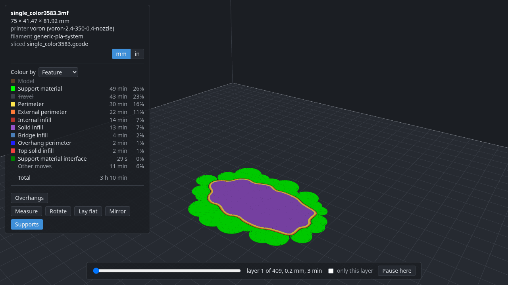

# deli guide

How deli works, command by command: the library of printers, filaments and processes it
slices with, a print and everything in its `deli.toml`, and the viewer. The
[README](../README.md) has the short version and the install line; [commands](commands.md)
lists every command and its options; the [FAQ](faq.md) has platforms, Windows, building
from source and what is not done yet.

- [Set up a printer](#set-up-a-printer)
  - [1. Find your printer](#1-find-your-printer)
  - [2. Choose it](#2-choose-it)
  - [3. Other filaments and processes](#3-other-filaments-and-processes)
  - [`deli import`: more control](#deli-import-more-control)
  - [Where the presets come from](#where-the-presets-come-from)
  - [Without OrcaSlicer's presets](#without-orcaslicers-presets)
  - [Name your printer](#name-your-printer)
  - [Tell deli where your printer is](#tell-deli-where-your-printer-is)
- [Print something](#print-something)
  - [Settings](#settings)
  - [Settings for every print, or for a profile](#settings-for-every-print-or-for-a-profile)
  - [Several models, copies, and models from the web](#several-models-copies-and-models-from-the-web)
  - [Slicing, and where the G-code goes](#slicing-and-where-the-g-code-goes)
  - [Supports](#supports)
  - [Where parts go, and plates](#where-parts-go-and-plates)
  - [Pauses, and changing filament](#pauses-and-changing-filament)
  - [`deli view`](#deli-view)
  - [What `deli.toml` holds](#what-delitoml-holds)

## Set up a printer

To slice, deli needs three things for your printer: the **printer** itself (bed size,
nozzle, start and end G-code), a **process** (layer height, speeds, infill: what
PrusaSlicer calls print settings) and a **filament**. You don't write any of them.
deli converts them from [OrcaSlicer](https://github.com/SoftFever/OrcaSlicer)'s
presets, which cover over a thousand printers, and choosing your printer gets all
three. You don't need OrcaSlicer installed. `deli setup` does the steps below for you;
this is what it does, and how to do more.

### 1. Find your printer

```
deli vendor                      # the vendors, with how many printers each
deli vendor Voron                # one vendor's printers
deli vendor "voron 2.4"          # or any part of a name: the printers that match
```

Orca's printer names end with the nozzle size, such as `Voron 2.4 350 0.4 nozzle`. Pick the one with the nozzle your printer has; most printers ship with 0.4 mm.
Vendor names are Orca's folder names, so Bambu Lab's printers are under `BBL`; the
list shows what a vendor's printers are called when it differs.

### 2. Choose it

```
deli printer "Voron 2.4 350 0.4 nozzle"
```

Any words of the name that are enough to tell it apart will do (`"voron 350 0.4"`), in
any order and any case. A printer that is not in your library yet is imported from Orca
as it is chosen, with the process and filament OrcaSlicer starts it with, and all three
become the defaults for new prints. Every choice ends with the same block, what the
print is now, with a note under anything that changed:

```
Imported printer 'voron-2.4-350-0.4-nozzle' from Orca 2.4.2's 'Voron 2.4 350 0.4 nozzle' (51 settings, 7 left out)
Imported process '0.20mm-standard-voron', Orca's default for this printer (94 settings, 16 left out)
  and made it the default process for new prints on 'voron-2.4-350-0.4-nozzle'
Imported filament 'generic-pla-system', Orca's default for this printer (27 settings, 20 left out)
  and made it the default filament for new prints on 'voron-2.4-350-0.4-nozzle'
Made 'voron-2.4-350-0.4-nozzle' your default printer for new prints
Printer   voron-2.4-350-0.4-nozzle  bed 350 x 350 mm, height 325 mm, nozzle 0.4 mm, firmware klipper
Filament  generic-pla-system  PLA, nozzle 220 °C, bed 55 °C
          from your config for this printer
Process   0.20mm-standard-voron  layers 0.2 mm, infill 15% cubic, perimeters 3
          from your config for this printer
Parts     none yet; add one with: deli add <file>
Sends to  nowhere yet; set with: deli config printers.voron-2.4-350-0.4-nozzle.host <moonraker://...|elegoo://...|octoprint://...>
Settings  none changed
```

`deli status` shows the block at any time.

You can slice now. The settings "left out" are ones PrusaSlicer's engine has no
equivalent for; they need nothing from you. [PRINTERS.md](../PRINTERS.md) says which of
Orca's printers deli has converted and sliced with, and why the rest fail. Slicing is
not the same as printing well; see [what is not done yet](faq.md#what-is-not-done-yet) for what has actually been printed.

Defaults are only filled in where you have none, so a second printer does not change
your default printer, and a filament you chose yourself stays chosen. Once imported, a
printer is in your library (`~/.config/deli/`), and choosing it again reads it from
there: a newer deli or a newer Orca never changes a printer under you.

A filament or process belongs to a printer: it is how a material, or a layer height,
prints on that machine's hotend and bed, which is why Orca keeps one per printer family
and names them `Generic PLA @System`, `Elegoo PLA @ECC`. deli keeps each under the
printer it was converted for, named without that tail: `generic-pla` under your Voron
and `elegoo-pla` under your Centauri are two files, each what Orca says for its
printer. `deli filament` lists the ones for the print's printer; choosing one another
printer has converts it for this one.

### 3. Other filaments and processes

```
deli filament                              # the filaments for your printer, the one in use marked
deli filament "Generic PETG @System"       # choose one
deli process                               # the processes for your printer
deli process "0.15mm optimal"              # choose one
```

`deli filament` lists the filaments made for the print's printer (or your default one),
with any you have used or loaded yourself, and marks the one in use and the default.
`deli process` does the same for processes, and `deli printer` lists your printers
first, each with its nozzles, then your printer's vendor's. It makes no difference
whether one has been used before: choose any of them by name, or words of it, and deli
fetches and converts it as needed, for your printer. Orca's Generic filaments (`Generic PETG @System` and so on) fit any printer; the
list counts them. `--default` makes a choice what new prints start with instead of
choosing it for this one.

### `deli import`: more control

`deli import orca printer|process|filament "<name>"` converts one of Orca's presets
without choosing it, and says more about the conversion: the notes on what
deli did, and with `-v` every Orca setting left out. Run it again to replace a profile
with a fresh conversion, after a deli upgrade that fixes the converter, say.
`--printer "<name>"` converts a process or filament for another printer than the one it
says it fits, `--printer-only` imports a printer without its defaults, `--name` stores
it under another name and `-o FILE` writes the INI file instead.

### Where the presets come from

deli reads Orca's presets from its GitHub repository at release 2.4.2, the release
[PRINTERS.md](../PRINTERS.md) was made from. A release never changes, so what is fetched
is kept in `~/.cache/deli/orca/` and read from there afterwards. Other sources:

- `deli import ... --ref main` (or any tag) reads another version of Orca's presets,
  for printers newer than the release. Only releases are kept; `main` is fetched each
  time.
- `deli import ... --local` reads the OrcaSlicer installed on this machine instead,
  **including presets you have edited or created in Orca**, which only exist there.
  `--orca DIR` adds a folder of Orca presets.

Listing every vendor makes one call to GitHub's API, which allows 60 an hour without
signing in, and is then kept like the rest.

### Without OrcaSlicer's presets

`deli load` takes a PrusaSlicer INI file from a path, a `file://` URL or an `https://`
URL, including a link to a file's page on GitHub; `--printer NAME` says which printer a
filament or process is for (default: the print's, else your default printer):

```
deli load printer  ~/Downloads/my-printer.ini --name my-printer   # a PrusaSlicer export, say
deli load filament https://example.com/profiles/my-petg.ini        # or a file someone hosts
deli printer my-printer                                            # then choose it as usual
```

Without `--name`, a profile is named as the file names it (PrusaSlicer's
`printer_settings_id` and the like), and `deli load` says what that is.

A full PrusaSlicer export holds a printer, a process and a filament; `deli load printer`
keeps only the printer's settings, so load it once for each. This repository's
`profiles/` has a few to try, converted from Orca's and checked to slice.

Anyone can host a printer this way: a PrusaSlicer INI file at any `https://` address.
Imported or loaded, a file never carries a printer's network address or API key; those
go in your config (below).

### Name your printer

Orca has a profile per nozzle, so its names are long and a nozzle change is another
profile. deli lets you name the printer you have, and keep its nozzles under that name:

```
deli printer "voron 2.4 350 0.8" --name voron    # your Voron, with its 0.8 nozzle in
deli nozzle 0.4                                   # you changed the nozzle: Orca's 0.4 profile comes in
deli nozzle                                       # its nozzles, and which is in it
deli printer voron                                # this print goes on it, with whatever nozzle it has
```

The address, the settings you give it with `deli set --printer voron`, and `deli send`
all go by the printer's name, whatever nozzle is in. Each nozzle keeps its own profile
and the filament and process a new print starts with. `deli setup` names a printer after
its host name. A printer you never named is one named after its profile, as before.

### Tell deli where your printer is

To send prints to it, deli needs its address:

```
deli config printers.voron.host moonraker://voron.local
```

And to change what new prints start with:

```
deli printer voron --default                      # the printer new prints start with
deli filament "Generic PETG @System" --default     # the filament new prints on it start with, with this nozzle
deli process "0.15mm Optimal @Voron" --default     # its usual process, with this nozzle
```

This writes `~/.config/deli/config.toml`, which you can also edit by hand. `host` is
where `deli send` sends; its scheme says what kind of host the printer is:
`moonraker://` (Klipper), `octoprint://` or `elegoo://` (Elegoo's Centauri Carbon)
(`api_key` alongside, if the host needs one). `filament` and `process` are what a new
print on that printer starts with, kept per nozzle, so you do not choose them again for
every print. They are defaults and nothing more: a print that chooses another filament
is sliced and sent like any other.

The three `--default` lines write the config's `printer` key (`deli config printer
<name>` sets the same one), and the `filament` and `process` of the nozzle the print is
on (`printers.<printer>.nozzles.<size>.filament`, or `printers.<printer>.filament` for
a printer named after its one profile). A print started in a new directory, with
`deli add` say, takes all three, written into its `deli.toml` like any other choice. A
print that wants something else chooses it with `deli printer`, `deli filament` or
`deli process` as usual, and changing a default later leaves the prints you already have
alone. `deli printer` lists your printers first and marks your default, and
`deli config` shows everything that is set.

## Print something

In a new directory:

```
deli add 3DBenchy.stl                 # STL, OBJ, 3MF or AMF; the print starts with your default printer, filament and process
deli add https://example.com/boat.zip # or fetched from the web: a model file, a zip of them, a page linking to them, or a Printables model (--file picks one of several)
deli printer "bambu p1s 0.4"          # another printer for this print, by any words of its name; its filament and process come with it
deli filament "generic petg"          # another filament than its default, converted for this printer
deli set infill 20%                   # or any PrusaSlicer setting by name
deli supports organic                 # automatic supports, for a model that needs them: on, off, grid, snug, organic
deli scale 150%                       # a bigger boat
deli scale z 60mm                     # or one side to a size, the others left as they are: z is up, however the part is turned
deli rotate 45                        # turned on the bed
deli mirror x                         # or its mirror image, for the other side of a pair
deli move 60 80                       # put it there instead of in the middle
deli pause 40                         # pause once layer 40 is done: change the filament for a two-colour boat
deli view                             # the Benchy on the bed in your browser, live; the shell stays free
deli slice                            # how long it takes, how much filament, and where it lies on the bed; the view then shows it layer by layer
deli send                             # uploads it, slicing first if needed; add --print to start printing
deli status                           # the print at a glance: printer, filament, process, parts, where it sends, settings, G-code
```

`deli printer`, `deli filament`, `deli process` and `deli nozzle` show the same block
after a change, with a note under each row that changed: what it was, and why the
filament or process followed the printer.

Several pairs go in one command, `deli set infill_pattern rectilinear infill 100%`,
checked together, each against the print with the pairs before it applied, and written
only when every one passes: a density only some patterns allow may follow its pattern,
and a batch with a bad pair changes nothing.

### Settings

`deli set` with nothing after it lists the settings this print changes, each with what
its profile had, so the few things you changed are never lost among the hundreds you
didn't. Settings that come from the printer, filament or process are not in that list;
to look one up, give its name, and deli says where its value comes from:

```
$ deli set
fill_density = 20%  (the process '0.30mm-standard-elegoo-cc-0.6-nozzle' has 15%)
layer_height = 0.25  (the process '0.30mm-standard-elegoo-cc-0.6-nozzle' has 0.3)
$ deli set temperature
temperature is not changed by this print; the filament 'elegoo-pla-ecc' has 210
$ deli set fuzzy_skin
fuzzy_skin is not changed by this print; PrusaSlicer's default has none
```

`deli unset layer_height` goes back to the profile's value. Several settings go in one
command, `deli set infill 20% walls 3`, and `deli unset` alone lists what there is to
remove. When you know roughly what a setting is called, give that: `deli set temp`
lists every setting with `temp` in its name, each with its value and where it comes from.

A value can come from a file, `@` in front of its name, which is how to give G-code:

```
deli set --printer voron start_gcode @start.gcode
deli set start_gcode                                    # shows it as lines
```

deli keeps the text, not the file's name, written as lines in `deli.toml` or your config,
so it reads and edits like G-code there:

```toml
[printers.voron.settings]
start_gcode = '''
M190 S{first_layer_bed_temperature[initial_extruder]}
M109 S[first_layer_temperature]
PRINT_START EXTRUDER=[first_layer_temperature] BED={first_layer_bed_temperature[initial_extruder]} MATERIAL=[filament_type]
'''
```

On the command line a line break is `\n`, as PrusaSlicer writes it. A filament's start and
end G-code are one value per extruder in PrusaSlicer, `;` between them; a value you give is
one extruder's, comments and all, and several extruders' are written quoted as PrusaSlicer
does (`"..." ; "..."`).

### Settings for every print, or for a profile

A setting you want on every print, whichever printer, goes in your config instead of
the print, with `--global`:

```
deli set --global infill 20%          # for every print, in ~/.config/deli/config.toml
deli set --global                     # list those
deli unset --global infill            # back to each print's profile
```

It lies under every print's own settings, which still win, so `deli set infill 30%` in
one directory changes that print alone, and the listing says which is which. A global
setting changes a print's G-code like any other change: `deli send` slices again first.

A printer that is not quite Orca's any more, after upgrades and modifications, keeps its
differences the same way, under its name; so does a spool that prints best a little off
its profile, or a process you always adjust:

```
deli set --printer voron max_print_height 310
deli set --printer voron start_gcode "..."
deli set --filament generic-pla temperature 215      # this print's printer's PLA (or your default printer's)
deli set --process "0.20mm Standard" walls 3
deli set --printer voron --filament generic-pla filament_max_volumetric_speed 30   # another printer's
deli set --printer voron                             # list a profile's
```

A filament's or process's settings are the printer's, as the filament itself is: the
pressure advance and the volumetric cap that suit a material in one hotend are not
right in another, so they are kept under the printer (`printers.voron.filaments.generic-pla.settings`).
A hotend's own limit, the most it can melt whatever the material, is a different
setting, `max_volumetric_speed`, and goes under the printer (`deli set --printer voron
max_volumetric_speed 30`): the engine applies it beside the filament's, the lower
winning. `deli set --printer` refuses the filament's cap, which there would silence
every filament's own.

They go in your config beside Orca's profile, not into it, so every print with that
profile has them, and a `deli import` of a newer Orca profile keeps them. This is deli's
custom profile: Orca's base plus your changes. The layers, each winning over the one
before: the chosen profiles; your global settings; the printer's; the filament's; the
process's; the print's own. A name can be any part of it that only one profile in your
library has.

### Several models, copies, and models from the web

A print can hold several models, each added the same way, and copies of one:
`deli add 3DBenchy.stl --count 4` prints four, arranged on the bed for you. With more
than one model, `scale`, `rotate`, `mirror` and `move` take the model's name first
(`deli scale 3DBenchy 150%`).

A model can come from the web: `deli add <url>` fetches it into the directory, adds it
like any file, and records the address as the part's `source` in `deli.toml`. The
address may be of the model file itself, of a zip holding model files, or of a page
linking to them, such as a file's or a folder's page on GitHub; with several model files
to choose from, deli shows them as a list to tick off when you are at a terminal (the
arrows move, Space ticks one, a every one, Enter adds what is ticked, Esc adds nothing),
and lists them otherwise; `--file NAME` picks one without asking, a pattern such as
`--file 'R*.stl'` every name it matches, `--file` again another, and `--all` every one.
Several added at once leave out the files the print already has. Adding the same address
again adds a copy. A Printables model's page (`printables.com/model/...`) works too:
the page itself only opens in a browser, but deli asks the site's API for the model's
files and their links, which it hands out without a login. Other model sites do not have
such a route: Thingiverse's pages and links refuse anything but a browser, and
MakerWorld, Thangs, Cults3D and MyMiniFactory want an account before handing out a file.
For those, download the file in your browser and `deli add` it; support for a site is
added when it turns out to have a way in like Printables', one site at a time.


### Slicing, and where the G-code goes

The G-code is kept in deli's cache (`~/.cache/deli/gcode/`), not beside `deli.toml`:
`deli send` and `deli view` find it there, and `deli send` slices again by itself when
the print has changed since. `deli slice -o FILE` (or `-o DIR`, `-o .` for here) also
writes a copy where you want it, to put on an SD card or open in another program.
After the time and filament, `deli slice` says where the print lies on the bed and how
far it is from each edge, and prints as `warning:` lines anything PrusaSlicer's engine
complained about while slicing (a tree support that lost a branch, say), each once.

### Supports

Supports are PrusaSlicer's automatic ones. `deli supports on` uses the style the
process came with (Orca's tuning for the printer carries over); `organic`, `snug` or `grid` pick one and turn them on; `--angle 45` supports
overhangs steeper than that, and `--buildplate-only` keeps them off the part itself.
`deli supports` alone says what is in force and where it comes from. Underneath these
are ordinary settings (`support_material`, `support_material_style`, ...), so
`deli set` shows them and `deli unset supports` turns them off.

### Where parts go, and plates

Parts are arranged on the bed for you, a single part in the middle. `deli move 60 80`
puts the middle of a part at x 60, y 80 instead, in millimetres from the bed's origin
(the axes `deli view` draws). The first time something on a plate is moved, everything
else on that plate keeps where it is, given a place of its own (`deli move` says so), so
that moving one thing never moves another; moved parts and copies that would overlap are
refused.
`deli move z -0.25` sinks a part a quarter of a millimetre into the bed, which is what
a part resting on an edge or a lip needs to get a first layer; what is below the bed
is not printed. `deli move auto` gives the placing back, and `deli translate` is the
same command under another name. A part with copies is moved a copy at a time:
`deli move box --copy 2 60 80` places the second, and `deli rotate box --copy 2 x 90`
turns it alone (rotating the part turns every copy). `deli arrange` has every part and
copy arranged again, as before any was moved; `deli arrange --plate 2` only what was
moved on plate 2, which stays there.

What does not fit on the bed goes on a second plate, and so on, as many as it takes, and
`deli slice` writes a G-code file for each (`stand-plate1.gcode`, `stand-plate2.gcode`)
and says what is on each and how long it takes. `deli move box plate 2` keeps a part to
plate 2, its place (`deli move box 60 80`) then on that plate, and `deli move box
--copy 3 plate 2` keeps only the third copy there; `deli move box auto` lets it go on
the first plate it fits on again. A print that fits on one plate never
mentions plates. `deli send` uploads every plate; `deli send --plate 2 --print` uploads
plate 2 and starts it, since a printer prints one plate at a time.

### Pauses, and changing filament

`deli pause 30` has the printer pause once layer 30 is done, to drop in a magnet or a
nut, or to change the filament: deli has no separate colour-change command, because a
pause is where you change it. What is written is the printer's own pause G-code (on
many printers `M600`, the filament-change command itself; `deli set pause_print_gcode`
changes it). Layers are counted as the slider in `deli view` counts
them, so slide to the last layer you want printed before the pause and use that
number. `deli slice` reports each pause with its height, and refuses a pause after a
layer the print does not have. On a print with several plates, `deli pause 30 --plate 2`
pauses plate 2; without `--plate` a pause is the first plate's.

### `deli view`

`deli view` opens a page in your browser and gives the shell straight back; the page
follows the print as you change it. It shows the parts on the bed and, once `deli slice`
has run and for as long as the G-code is still the print's, every extrusion in it,
supports included, coloured by what it is for. The parts are then drawn faint over the
extrusions, or hidden: Model in the legend shows or hides them, and they come up by
themselves for the tools that need them. When the print has changed since it was
sliced, or has never been, the page shows the parts and says so, with a Slice button
that runs `deli slice` and shows what it printed. Sending stays in the shell. A print
with several plates has a button for each, and the page shows one plate at a time.

The slider at the bottom goes through the layers, each with the time it takes, cutting
the parts at the same height; a box shows only that layer. With no G-code it cuts the
parts at a height instead, to show their inside. The colours turn lighter where the
print pauses. The legend says how long each kind of extrusion takes, and travel; click
one to hide or show it. "Colour by" colours the print by speed, flow (mm³/s) or layer
time instead, from blue for the least to red for the most, which shows at a glance what
is slow. The times are PrusaSlicer's estimate from reading the G-code back, as its own
G-code viewer makes it, and can be a minute or two from the one `deli slice` reports.
Overhangs shows in red the faces supports would hold up (at the print's
`support_material_threshold`, or the angle PrusaSlicer works out when it is 0).

Click a part to select it, Shift-click to add another, or click a part's name in the box
for every copy of it (Ctrl-click adds or takes one, Shift-click every part down to it from
the last clicked, and All takes every part; the parts are listed in a panel of their own on
the right, which scrolls). A tool used on a selected part acts on the whole selection, one command per copy,
and the row under the list acts on it without a click on the model: Rotate turns each
selected copy on the bed by the degrees beside it, Mirror x and Mirror y mirror each
selected part, Scale makes each selected part the percentage beside it, and Remove gives
the `deli remove` that takes the selection out. Click the empty bed, Clear or Esc to
select nothing.

Dragging, Rotate, Lay flat and Mirror change the print with deli's own commands: drag a part over
the bed for its `deli move` (a copy is moved by itself, with `--copy`; a drag that would put
it off the bed or on another part offers nothing); with Rotate (or R) drag a part around to
turn it on the bed, by 15°, or 1° with Shift, for its `deli rotate ... z` (and, for one not
yet placed, the `deli move` that keeps it where it is); or with Lay flat click a face of one
for the `deli rotate` that lays that face on the bed (that copy's only); with Mirror click a side of one
for the `deli mirror` along that side's axis (a side for left to right, the top for top to bottom); Arrange, once something has been
moved, gives `deli arrange` (`--plate N` for the plate shown, on a print of several); Pause here, beside the layer slider, does the same for `deli pause` at that
layer. The page shows the command, and Apply runs it (Copy, to run it yourself); either
way `deli.toml` changes as the command says and the page follows. Once the print is
sliced, and deli knows the printer's address, Send and Print run `deli send` for the
plate shown (Print, which starts the printer, asks once more). Only the page at the
address `deli view` printed can apply commands. To measure, press Measure (or M) and
click two points on the parts or the print: the line follows the pointer from the first,
and the page shows the distance between them and along each axis, snapping to a corner
of a part when you click near one. Esc clears; a right-click clears and puts the tool
down. The mm / in switch, below the print's description, shows every length on the page (sizes,
places, layer heights, measurements) in millimetres or inches; commands stay in
millimetres. Supports, beside the tools, gives `deli supports on` or `off`.

The page is served in the background until it has been closed for ten
minutes, or until `deli view --stop`. When the printer's profile asks for a thumbnail,
`deli slice` draws one into the G-code for the printer's screen.



### What `deli.toml` holds

`deli printer`, `deli filament`, `deli process`, `deli set`, `deli supports`,
`deli scale`, `deli rotate`, `deli mirror`, `deli move` and `deli pause` without arguments show what
is chosen. `deli remove`, `deli unset`, `deli scale 100%`, `deli rotate 0`, `deli mirror off`,
`deli move auto`, `deli arrange` and `deli pause off` undo things. Everything is in `deli.toml`, which
is plain TOML you can edit, comment and commit:

```toml
pause = [40]

[printer]
name = "voron-2.4-350-0.4-nozzle"
sha256 = "9510435c7c2100a23514b823aaab26fc37e9efe6a7e8031c1a2e03ecb687192c"

[[part]]
file = "3DBenchy.stl"
scale = [1.5, 1.5, 1.5]
rotate = [0, 0, 45]
at = [60, 80]

[settings]
fill_density = "20%"
support_material = 1
support_material_auto = 1
support_material_style = "organic"
```

The filament and the process have tables like the printer's. The hash records which
version of the printer the print was set up with; if the printer in your library
changes, `deli slice` says so and `deli printer <name>` accepts the new version.

Before a first real print: `deli send` without `--print` only uploads, so you can
check the file arrived and start it from the printer's own screen.
